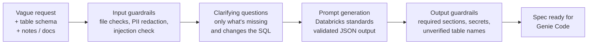

# PromptForge for Databricks

**Turn vague data requests into safe, Databricks-ready prompts — without leaking personal data.**


## The problem

AI agents like Databricks **Genie Code** are excellent at *executing* data work: they see Unity Catalog metadata, write the SQL and run it. But the request that reaches them is usually the weak link:

> *"Can you get me a sales report for the board?"*

Gross or net revenue? Which months? Monthly or quarterly? Which time zone? Are refunds included, and in which month do they count? A request like this forces any agent, or any analyst, to **guess**. And the requirements often arrive in an email or a Word document that contains customer names, emails or card numbers that should never be pasted into an AI tool.

**PromptForge sits in front of the agent.** It turns a vague business request into a clarified, PII-safe, well-specified task, ready to paste into Genie Code or any other data agent.

## How it works



1. **Describe what you need** in one line, and optionally paste table schemas (Databricks `DESCRIBE TABLE` output or `CREATE TABLE` statements) and notes or a requirements document.
2. **Check my request.** PromptForge asks up to four clarifying questions, each with options and a sensible default, and only about information that is missing *and* would change the SQL.
3. **Generate.** You get a structured spec: business question, data sources, metric definitions, filters and time range, dialect and performance rules, expected output and validation queries. Confirmed answers are stated as facts; anything still assumed is listed and marked for confirmation.

## Features

**Databricks-aware prompts**
- Unity Catalog three-level names (`catalog.schema.table`), copied exactly from your schema; the model is told never to invent names, and any table name not in your input is flagged. Placeholders like `<catalog>.<schema>.<table_name>` are used when no schema is given.
- Read-only by default, no `SELECT *`, CTEs, partition pruning, and `MERGE` only when writes are explicitly requested.
- Safe time logic: concrete relative ranges and half-open filters (`>= start AND < next_start`), never `BETWEEN` on timestamps.
- Correct SQL patterns: window functions with `PARTITION BY` and `ORDER BY`, and child tables aggregated before joining to avoid double counting.
- Validation queries that reconcile independently against the source, plus duplicate checks on the record key.

**Guardrails**
- **PII redaction before any model sees your data:** emails, phone numbers, card numbers (Luhn-validated), US SSN, UK National Insurance numbers, Indian Aadhaar (Verhoeff-validated) and PAN. Checksums keep ordinary numbers such as order IDs from being redacted, and ISO dates and times are protected.
- **Prompt-injection detection:** uploaded and pasted content is treated as data, never as instructions; suspicious phrases trigger a warning.
- **Blocked topics** with friendly messages.
- **Input limits:** uploads in txt, md, pdf or docx, up to 10 MB per file and 30 PDF pages; up to 50,000 characters of text per field and a 500-character request.
- **Output checks:** every required section must be present, no leaked secrets (API keys, tokens, private keys), and a warning for any table name that wasn't in your input.
- **Friendly errors** everywhere; users never see a stack trace.

**Flexible models**
- Switch providers in `.env` with no code changes: **Ollama** (local and private), **Groq** (free tier) or **Anthropic**.
- Structured JSON output (schema-enforced on Ollama, JSON mode on Groq), validated on every reply, with an automatic retry when a model returns invalid or incomplete results.

## Quick start

**Requirements:** Python 3.11+, and either [Ollama](https://ollama.com) or a free [Groq API key](https://console.groq.com).

```bash
git clone https://github.com/adeel-genai-labs/prompt-forge.git
cd prompt-forge
python -m venv .venv
```

Activate the environment:

```bash
# Windows (Command Prompt)
.venv\Scripts\activate

# macOS / Linux
source .venv/bin/activate
```

Install and configure:

```bash
pip install -r requirements.txt
cp .env.example .env        # Windows: copy .env.example .env
```

Edit `.env` (see [Configuration](#configuration)), then run:

```bash
streamlit run app.py
```

The app opens at http://localhost:8501.

## Configuration

All settings live in `.env`, which is git-ignored and never committed.

| Setting | Purpose | Default |
|---|---|---|
| `LLM_PROVIDER` | `ollama`, `groq` or `anthropic` | `ollama` |
| `OLLAMA_TEXT_MODEL` | Local model for Ollama | `llama3.2` |
| `GROQ_API_KEY` | Your Groq key (free tier) | none |
| `GROQ_TEXT_MODEL` | Groq model | `openai/gpt-oss-120b` |
| `ANTHROPIC_API_KEY` | Your Anthropic key | none |
| `ANTHROPIC_MODEL` | Anthropic model | `claude-sonnet-5-5` |

For Ollama, pull the model first: `ollama pull llama3.2`. Small local models work, but larger hosted models follow the Databricks rules more reliably.

## Example

**Input:** `Get me a sales report for the board`, plus the `DESCRIBE TABLE` output for `samples.bakehouse.sales_transactions`.

**Clarifying questions** (example): Which time range? Monthly or quarterly? Should revenue be gross or net? Should any transactions be excluded?

**Output:** a complete spec using the real column names, with a concrete date filter, metric definitions, an exact expected row count, and validation queries, labelled *"Ready to paste into Genie Code (or any data agent)"*.

<!-- Add your before/after comparison here: Genie Code's SQL from the vague request vs. from the PromptForge spec. -->

## Project structure

```
app.py                 Streamlit UI (no business logic)
src/
  extractors.py        Text from pasted input, .txt/.md, PDF (PyMuPDF) and Word .docx (python-docx)
  schema_input.py      Parses DESCRIBE TABLE / CREATE TABLE into a compact schema
  guardrails.py        Input, content and output checks; PII redaction
  generator.py         Prompt generation, clarifying questions, retries
  providers.py         OpenAI-compatible providers (Groq) as a data-driven dict
  targets.py           Databricks guidance, required sections, clarify topics
  schema.py            Pydantic models for the generated prompt and clarifying questions
tests/                 pytest suite, one file per module, all model calls mocked
samples/               Made-up test inputs (vague request, PII, injection, ...)
docs/claude-code-log.md  Development log
```

## Testing

```bash
pytest -v
```

316 tests cover extraction, schema parsing, every guardrail (including false-positive cases such as dates, order numbers and "kill the process"), provider errors (missing key, rate limits, unknown model), retries and the Streamlit flow. All model calls are mocked, so the suite runs offline and free.

## Design decisions

- **Plain functions over classes.** Easier to read, test and explain; Pydantic is used only where validation is the point.
- **Data-driven configuration.** Prompt rules (`TARGETS`) and API providers (`PROVIDERS`) are dictionaries, so adding a provider or a new use case is a data change rather than new code.
- **Guardrails on both sides of the model.** Input is redacted and checked before generation; output is validated, re-redacted and checked for invented table names.
- **Warn, don't block,** for checks that can have false positives (injection phrases, unverified names).
- **Configuration over hardcoding.** Hosted model IDs change (Groq retired `llama-3.3-70b-versatile` in August 2026), so model names live in `.env`.

## Known limitations

- PromptForge only knows the schema you paste in; it doesn't connect to your workspace. Genie Code has live Unity Catalog context; PromptForge's job is the request, not the execution.
- Phrase lists for blocked topics and injection attempts are a first line of defence and can't catch everything.
- PII patterns cover common formats only. Phone numbers need separators, and checksums reduce but don't eliminate false matches.
- The unverified-names warning doesn't check two-part names mentioned in plain prose.
- Output quality depends on the model; small local models may need the automatic retry more often.

## Roadmap

- "Try the prompt": generate the SQL directly in the app
- SQL safety check on generated SQL (flags `SELECT *`, writes, missing three-level names)
- A small evaluation set to score prompt quality on every change
- Optional additional providers (OpenRouter, Databricks Model Serving)

## How it was built

Built step by step with Claude (planning and review) and Claude Code (implementation), with every module reviewed, tested and run live before moving on. The full development history is in [`docs/claude-code-log.md`](docs/claude-code-log.md).

## Author

**Adeel Ahmad** · [LinkedIn](https://linkedin.com/in/your-profile-url) · [GitHub](https://github.com/adeel-genai-labs)
